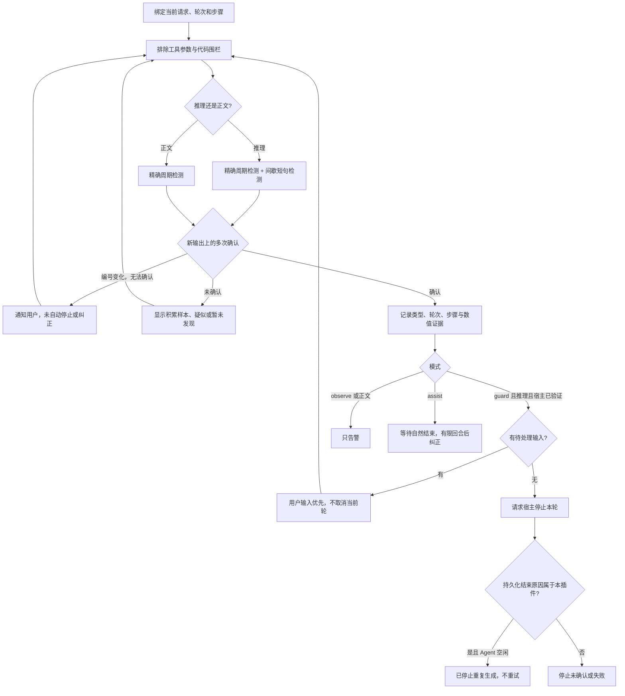
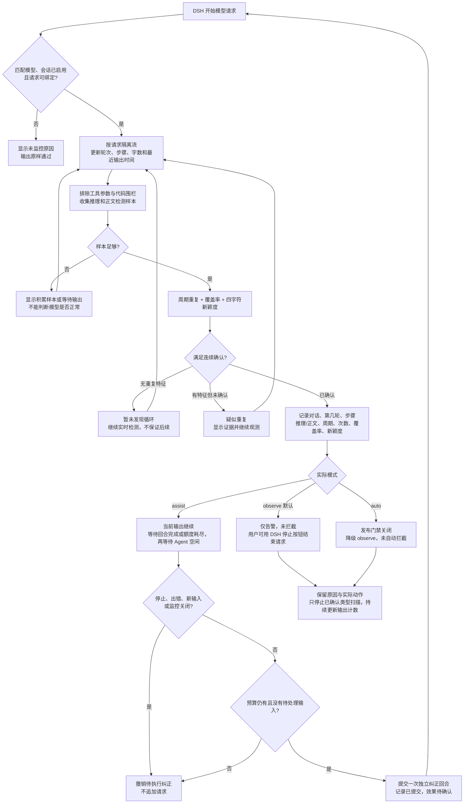

# DSH Flash Stabilizer 0.1.9

0.1.9 使用带版本号的运行入口，并将本地模块打包在一起，避免在线升级后复用旧模块；启动期间从 DSH 启动器元数据读取宿主安装锚点，仍要求宿主包版本一致，配置提示不能解锁未知版本。网页自动化测试预先阻断音频及下载资源，避免唤起下载器；不修改日常浏览器或下载器设置。

## 0.1.7：仓库入口与自动更新

插件页新增可点击的 [GitHub 仓库](https://github.com/MyRemme/dsh-flash-stabilizer) 入口，以及「插件更新」区域：当前版本、最新正式版、最近检查、更新状态、自动更新开关、检查与安装按钮。仓库保持私有，浏览器访问需登录有权限的 GitHub 账号。

自动更新默认关闭，开启后在启动时及每 6 小时检查仓库的最新正式 Release；也可手动检查与安装。更新设置保存在当前 profile 的 `.flash-stabilizer/updates/state.json`，不随插件重载丢失。只接受递增的正式版本，跳过草稿、预发布和降级。下载包保存在同目录，方便核查和手动恢复。

更新请求固定访问此仓库的 GitHub API。私有仓库鉴权优先读取 `DSH_FLASH_STABILIZER_GITHUB_TOKEN`、`GH_TOKEN`、`GITHUB_TOKEN`，否则调用本机 `git credential fill` 使用已有凭据，不弹出登录、不保存令牌，也不把令牌返回界面或诊断导出。令牌需有此私有仓库的内容读取权限。无法访问时界面会报告权限、网络或尚无正式 Release 的问题，不影响推理监控。GitHub 签名资源跳转不转发鉴权头。

安装前校验 GitHub 资产摘要或 `checksums.sha256`、包名与版本、压缩包路径和条目类型、安装脚本及 DSH/Node.js 兼容范围。仅在宿主列出的所有 Agent 都空闲、无待处理输入、无监控请求时交给 DSH `pluginManager.installBundle()`；下载结束后再次检查空闲。更新期间新发起的请求仍由宿主管理，不锁定聊天。安装后需重启时明确显示「已安装，需重启 DSH 生效」，不会自行重启、结束对话或关闭其他进程。未知/缺少更新接口的宿主停用更新控件，监控仍独立工作。

SHA-256 用于校验发布资产完整性，并非独立签名；仓库账号或 Release 本身被攻破不在此校验的保护范围。包内携带已固定的更新模块运行依赖，更新不授权额外依赖构建脚本。安装失败由 DSH 恢复其清单和锁文件；插件保留下载包，不承诺自动回滚所有宿主加载失败。正式版发布者应先完成测试再创建 Release，流程见文末。

## 0.1.6：审查问题修复

- **无法确认时通知用户**：短句重复间若存在至少三种含数字的变化单元，且占单元数至少 15%，保留“重复特征待确认”状态，提示可能是逐项检查；不自动停止、不提交纠正，继续检测。条件消失后若后续输出满足重复确认规则，仍可触发防护。这个规则不能识别所有正常进展，也可能让带变化数字的真实循环只告警。
- **追加输入优先**：检测确认时若宿主已有待处理的下一步或下一轮输入，不自动取消当前轮或追加纠正，显示“用户输入优先”，让宿主按原有流程消费输入。此修复避免取消后把输入留在空闲队列；它不会强制打断仍在输出的响应，必要时用户仍可使用 DSH 停止按钮。
- **正文与推理独立保护**：正文确认后只停止正文重复扫描，后续推理仍继续检测。同次请求每种内容类型最多记录一次确认；最多可分别有一条正文和一条推理确认，不代表两次请求。

验证范围和限制见[审查修复报告](evaluations/2026-11-12-review-fixes/REPORT.zh-CN.md)。

## 0.1.5：针对实际会话的修复

新增 `mode: guard` 防护停止：确认**推理**出现机械重复后，调用宿主 `agent.cancel()` 停止本轮，不追加纠正请求，不重放工具。仅对已通过宿主测试的官方版本开放；未知版本和版本提示与实际包不一致时只告警。界面分别显示「已请求中断」「已停止重复生成」和「停止结果未确认」，只有收到属于本插件的持久化 `turn/end` 及空闲通知后才显示已停止。正文重复仍只告警。默认安装配置保留 `observe`，本机可配置 `guard`。

旧版漏掉了“重复短句之间夹着变化文字”的循环，以及不足 1536 字符的短推理。新增推理专用分支：从 512 个有效字符起，每至少 128 个新字符检查最近 512 字符；按句末标点、换行及括号切分短句，取出现至少 `minRepeats` 次的前四种短句。候选短句最长 24 字符且不含数字；确认要求至少 24 次出现、合计至少 80 个文字字符、占文字至少 35%、占短句单元至少 75%、在窗口三个区段均分布，新增四字符片段比例不高于 45%，连续 `confirmations` 次成立。不匹配具体词语，不在正文启用该分支。精确周期分支仍使用原来的 1536 字符及 85% 覆盖规则。低于确认条件的证据只显示疑似重复。

用户提供的实际会话共 1530 次助手记录，按原始 delta 与代码围栏回放：旧版确认 0 次，新版确认 330 次；独立短句筛选的 349 次候选中检出 330 次，其中 23 次既无正文也无工具调用的记录全部检出。其余 19 次没有全部达到连续确认条件。这是已知会话回放结果，不是线上检出率或误报率，也不是新 API 请求的恢复实验。原始会话、模型路由与个人路径未纳入仓库。详见[会话回放报告](evaluations/2026-11-12-session-repair/REPORT.zh-CN.md)。



同时修复内容块槽位未释放导致后续监控遗漏、重叠请求事件轮次错误、撤销后纠正状态过期、历史会话计数归零。历史计数明确标注为最近保留事件的计数，不能当作完整累计。

DeepSeek Harness 原生 Cordis 插件，监控 Flash 模型的重复推理、正文和重复工具结果，提供可选的有限软纠正。包内含构建产物，安装时不需要编译。

## 如何缓解 LLM 采样退化与推理空转

### 本插件处理的症状

目标现象是：长上下文与较高推理努力下，模型在推理中反复输出“好。执行。好。”或“Write. / Output. / Let me write.”等短句，长时间没有新的正文或工具调用。这里的“采样退化”描述的是可见症状；插件没有访问服务端 logits 或采样器内部状态，不能据此确定根因，也不能修复模型权重或提供方的解码实现。

**当前能力是检测、告警、可选防护停止及回合后软纠正。默认 `observe` 不会停止当前空转；`guard` 可以请求宿主停止当前重复推理；`assist` 要等当前回合自行结束。** 插件未证明能消除模型内部采样退化，也不保证提供方收到取消后何时停止计费。

### 精确周期分支

1. 从 DSH 的统一输出流中读取推理和正文，按会话、请求尝试和内容块分别观察；工具参数不参与文本检测，Markdown 代码围栏内的内容被跳过。
2. 每个内容块保留最近 4096 个字符，累计至少 1536 个字符后开始检查；两次检查之间至少有 256 个新字符。这里是 JavaScript 字符串长度单位，不是模型 token 数，也不是计时器。
3. 在窗口末尾寻找精确的周期重复：默认候选周期为 16–512 个字符，至少重复 6 次。更短的短句可通过周期的整数倍命中；周期长度不一定等于自然语言的一句话。
4. 确认还要求重复片段覆盖窗口至少 85%，最近 1024 个字符的相邻四字符片段中新增片段比例不高于 15%，并在周期兼容的连续 3 次检查中成立。第一次检查尚无前窗参照，不能直接以“低新颖度”确认。
5. 确认后记录内容类型、周期、次数及轮次/步骤，并显示会话告警。同次请求只停止已确认内容类型的重复扫描；另一种类型仍继续检测，模型输出仍原样传递。

这是一种文本规则，风险分数不是概率，也不等于测得了采样分布的熵。它可能漏掉同义改写、跨内容块或较松散的语义循环，也可能把有意重复的普通文本判为告警。没有工具调用本身不触发中断；重复工具结果有独立的告警规则，不能单独证明采样退化。

### 检测与拦截流程图

下面说明观察和回合后纠正路径；0.1.5 新增的防护停止分支见文首流程图。`auto` 自动停止后续接仍关闭，`guard` 只停止、不续接，不能把告警或追加纠正显示成“拦截成功”。



### 实际动作与限制

| 模式 | 确认重复后的动作 | 能否打断当前空转 | 验证与限制 |
|---|---|---|---|
| `observe`（默认） | 显示告警、证据和记录，由用户决定停止或继续 | 否 | 不追加模型请求，不自动重试 |
| `assist`（可选） | 当前回合以正常完成或输出额度耗尽结束，且 Agent 空闲后，提交一次独立纠正回合 | 否 | 增加模型请求和费用；没有缩短当前历史或改变采样参数，仍可能再次重复 |
| `guard`（可选） | 确认推理重复后请求宿主停止，单独记录停止确认 | 是，需宿主接受 | 35 个可用发布版通过确定性宿主测试；不重试，不宣称服务端停止计费 |
| `auto` | 当前发布包警告并降级为 `observe` | 否 | 自动取消后续接尚未通过真实提供方验证，不提供可解锁配置 |

`assist` 追加的中文纠正消息与 [实现](src/recovery.ts) 一致：

> 检测到当前步骤出现重复推理。请依据原任务和已有工具结果，先确认当前工作区状态，再继续下一项必要操作。不要重复已经完成的工作，不要自动重放写入、删除、Git 或部署操作；无法确认状态时明确说明阻塞原因。

它的作用是为下一次生成提供一个回到任务的起点，效果依赖模型下一次响应。已经发出的流不会实时收到这条消息。默认每个用户任务最多预留两次纠正机会；新用户输入会重置预算，状态回收或插件重载也会重置，因此这不是跨重启的总费用上限。用户停止、错误、新输入、禁用监控或卸载会撤销待执行纠正；停止在提交前生效时，不追加纠正回合。已经提交的纠正回合需由宿主停止。界面的“已提交纠正”只表示提交成功，恢复效果需要另行检查。如需启用 `assist`，按下文[配置](#配置)修改插件模式，安装默认值仍为 `observe`。

### 实际遇到空转时的处理步骤

1. 点击输入框下方的 **Flash 状态**，查看是疑似重复还是确认重复，核对周期、次数、轮次/步骤及实际动作。长思考、空正文或触及输出上限，单独出现时都不足以证明短句空转。
2. 如果已确认机械重复且当前仍在生成，可使用 **DSH 对话自身的停止按钮**结束请求。“暂停监控”只关检测，不会停止模型。手动停止后 `assist` 不再自动补发；需要你明确发起下一轮。
3. 重试前先核实文件、Git 状态和已经执行的工具结果，防止重复写入或重复提交。根据这些事实整理“目标、已完成、未完成、必要路径和约束”，通过宿主支持的压缩/分支/新会话功能缩短输入；避免把大段空转输出作为新的任务说明反复复制回模型。新会话也有遗漏上下文的风险，应保留必要约束。
4. 如需比较推理强度，可在 DSH 的模型设置中对同一任务单独尝试较低档位。插件不自动调低推理努力；较低档位可能影响复杂任务质量。以实际发出的提供方参数为准，而不是只看界面标签。
5. 设置适合任务的单次输出额度、请求超时和有界重试，避免一次失败无限消耗。输出额度过小也会导致只有推理、没有最终答案；停止或超时不代表已经核实服务端停止计费。
6. 如果相同输入持续复发，可对照尝试当前提供方支持的其他模型，并核对提供方/模型版本的已知问题。每次只改变一个因素，比较重复次数、工具进展、最终产物和成本，不把一次正常响应当作根治证据。

以上是供人工对照验证的缓解操作，不是本插件已自动实现的能力，也不是已测得有效率的承诺。**当前版本没有自动截断推理、压缩上下文、修改采样参数、切换模型或自动验收任务结果。**

### 官方 DeepSeek API 的参数边界

按 2026-11-11 核对的官方接口文档，推理模式下 `temperature` 不生效；`deepseek-flash` 的 `top_p` 在该模式下仅在 0.95–1.0 范围内生效。不能把“改成 temperature=0”或“top_p=0.1”写成已验证的修复办法。[Chat Completions 参数说明](https://api-docs.deepseek.com/api/create-chat-completion/)

降低推理努力可用官方 Chat Completions 的 `reasoning_effort: "low"` 做对照；这不是本插件的配置字段，DSH 会由适配器转换。携带工具时不要手工删除历史 `reasoning_content` 或工具关联；清理上下文应使用宿主提供的功能。[思考模式与工具回传要求](https://api-docs.deepseek.com/guides/thinking_mode/)

这些接口规则不等于恢复效果验证；其他模型、协议或提供方需要核对各自规则。插件始终让宿主负责序列化和提供方适配。

### 已有证据能说明什么

- **检测证据**：20 份本机历史短句空转流按原 delta 边界回放，全部检出；能说明这些已知样本可被检测，不能推算线上检出率或真实节省额度。
- **宿主机制**：确定性模型适配器验证了告警、有限后续回合、用户停止优先及卸载；不能据此声称官方 API 取消已停止计费或模型已恢复。
- **原生模型对照**：无额外 Agent 注入的 20 次基线请求，以及长上下文/推理档位补测的 47 次请求，均未复现目标短句空转；其中空回复和截断单独记录，不冒充命中。尚无真实提供方上“同一触发输入、无插件/有插件”的恢复成功对照。

证据和局限见 [本地历史回放](evaluations/2026-11-11-dsh-local/REPORT.zh-CN.md)、[原生基线](evaluations/2026-11-11-pi-native/REPORT.zh-CN.md) 和 [触发条件补测](evaluations/2026-11-11-pi-trigger/REPORT.zh-CN.md)。

## 当前可用功能

- 流式检测确定性周期重复，包括“好。执行。好。”一类短句轮转；按会话、模型请求和内容块隔离，连续多次观测后确认。
- 同次请求确认重复后释放该内容类型的检测窗口，另一种类型仍继续扫描；仍原样转发全部输出。重叠流分别绑定请求状态，旧流结束不会清除新流监控。
- 排除工具参数 JSON，跳过 Markdown 代码围栏，降低重复模板代码的敏感度。
- 对五分钟内相同工具、相同参数且结果不变的重复执行告警。结果变化会重置该指纹的计数。
- `observe` 默认只告警；`assist` 在确认重复后等待当前回合正常结束或耗尽输出，再通过宿主 `agent.followup()` 开启独立纠正回合，每个用户任务最多两次。错误、用户停止、新用户输入、禁用会话或卸载会取消待执行的纠正，不向当前步骤注入消息。
- 提供原生「Flash 防空转」侧栏、插件详情面板和重复告警提示，显示监控请求数、最近监控时间、检测记录及实际纠正动作。
- 面板复用 DSH 原生按钮、开关、图标及明暗主题；每个对话的输入框下方显示独立监控状态，点击可查看该对话的重复原因、轮次、步骤和实际动作。
- 提供暂停 / 继续、刷新、离线自检及去标识日志导出；另支持会话级开关和有界本地 JSONL 日志。

插件不改写流内容、历史、工具参数或采样设置，不自行执行、跳过或重放工具。`guard` 会在确认推理重复后请求宿主停止当前轮，且不自动续接。`assist` 会增加后续模型回合和费用；当前回合需要自行结束，纠正提示才可能生效。独立回合避免宿主保留 `max-tokens` 状态而在执行一次工具后提前停止。

**本版开放 `guard` 防护停止，未开放自动停止后恢复。** `mode: auto` 会明确警告并降级为 `observe`。真实提供方的取消后续接及跨重启恢复预算尚未完成验证。内存中的软纠正预算在新用户输入、会话状态被回收或插件重新加载后重置。

本版尚未实现 Git diff、文件哈希、编译/测试格式解析、语义循环判断或质量验收，不宣称达到计划书中的检出率、恢复率、节省 Token 或代码能力指标。当前工具告警仅代表“调用及结果重复”，不能证明任务没有进展。

## 版本覆盖

截至 **2026-11-11**，已审查官方 GitHub 的 37 个发布条目，范围为 `0.1.0-rc.7` 至 `0.2.2-rc.1`；具体条目和证据见 [兼容性矩阵](compatibility/MATRIX.md)。

- 35 个能取得 npm 宿主包的版本通过真实 Cordis / AgentLoop / Session / Tools 核心测试，使用确定性模型适配器。
- `0.1.2-alpha.1`、`0.1.3-alpha.1` 缺少对应 npm 宿主发布包，只有源码审查和协议回放覆盖，尚无运行验证。
- 新版使用 `agent/assistant-stream`，早期版本使用原样转发的 `llm/stream` 适配器。
- 未知版本按观察接口回退，但安装器可能因明确的 `engines.dsh` 版本白名单拒绝安装；需要补充验证后更新包。源码修改版、第三方分支及将来的版本不在承诺范围内。

核心测试不等于真实 DeepSeek API、桌面端安装或真实任务效果测试。插件自身要求 Node.js >=22.18.0，同时必须满足所用 DSH 版本自身的 Node.js 要求；当前全部测试在 Windows / Node.js 24.20.0 上运行。

## 查看是否生效

在侧栏打开 **Flash 防空转**，或进入 **插件 → dsh-flash-stabilizer → 配置**。新增前端模块后可能需要刷新 Harness 页面。

- 「监控在线」表示服务已连接并启用；「已监控请求」及「最近监控请求」在实际匹配的 Flash 请求开始消费时更新。
- 对话输入框下方的「Flash」状态分别显示待请求、监控中、最近请求未发现重复、模型不匹配、暂停或检测不完整。当前请求状态与历史告警分开；历史重复不会覆盖新请求的状态。
- 点击对话状态可查看周期长度、重复次数、推理或正文类型以及轮次与步骤。观察模式明确显示「仅告警，未拦截、未中断输出」；待纠正、纠正已提交及请求中断分别记录，不代表恢复或中断成功。
- 插件完整页面的「对话实时监控」列出对话名称及匿名短标识、当前轮次/步骤、推理与正文字数、检测次数、工具结果数和最近输出/检查时间。每 2 秒同步；可按对话筛选事件并用「打开对话」返回 DSH 原生对话。只有已跟踪的会话或仍保留事件的会话会出现，不能补看安装前的全部历史。
- 实时状态区分等待首个输出、积累检测样本、暂未发现循环、疑似重复、确认重复和检测不完整。30 秒无新输出显示「等待输出，尚不能判断」，不会仅凭等待判定循环。短回复未达到检测门槛时显示样本不足，不显示“已验证正常”。
- 连接中断时，对话列表显示「状态已过期」，保留数字明确标记为上次同步数据；重新连接成功后恢复实时状态。
- 检测记录显示所属对话、第几轮、步骤、重复发生在推理还是正文、周期长度、次数、窗口覆盖率、新增四字符片段比例和实际动作。只显示数值证据，不展示原始重复短句或私人推理。暂未发现循环只描述已收到的输出，不能保证后续不退化、没有其他语义循环或任务结果正确。
- 检测确认后显示界内告警和记录；纠正意图、已提交及预算耗尽分别标注。「已提交纠正」是累计提交数，不代表恢复成功。
- 重复短句间仍有变化编号、无法确认是否空转时，显示「重复特征待确认」通知及原因，不自动停止或纠正。该提示也保留在所属对话的轮次/步骤记录中。
- 「暂停监控」不会停止模型或工具，只撤销待执行纠正并停止监控；恢复从下一次请求开始。暂停状态在插件重载后重置。
- 「离线自检」只用内存样本检测，不调用模型、不修改会话、不计入真实告警。
- 「导出诊断日志」导出最近 100 条内存事件及累计统计，默认无需开启磁盘日志。插件重载会清空内存记录；磁盘日志开关及写入故障会在面板显示。

界面使用 Harness 原生插槽和已认证连接。35 版本核心宿主测试不等于所有版本的界面测试；旧版没有对应界面或连接服务时，后台监控可独立运行。

对话标题通过宿主已有会话列表在本机界面中读取；原始会话 ID 只用于已认证的界面导航。诊断导出、磁盘日志和仓库报告不包含对话标题或原始 ID；旧宿主没有导航服务时显示匿名短标识并停用跳转。

## 安装与卸载

先确认 `dsh` CLI 可用，并确定你实际使用的 profile 名称。下面以 `desktop` 为例；其他 profile 请替换两条命令中的 `desktop`。安装到哪个 profile，就只在该 profile 中生效。

```powershell
dsh plugin --profile desktop add ./artifacts/dsh-flash-stabilizer-0.1.9.tgz
dsh --profile desktop --dump-config
```

检查组合后的配置包含 `id: flash-stabilizer` / `name: dsh-flash-stabilizer`，再重新启动相应 profile 的 DSH。原包默认 `mode: observe`。

```powershell
dsh plugin --profile desktop remove dsh-flash-stabilizer
```

安装包保存在本地及私有 GitHub Release，源码保存在同一私有仓库，未发布到 npm。安装方式依据 [官方插件打包教程](https://github.com/deepseek-ai/deepseek-harness/blob/fcc0ad462172522aaf5c93a7b2e01f6b9f0b0159/docs/user/develop/basic/publish.zh.md)。

## 配置

在所用 profile 的 `cordis.patch.yml` 中覆盖插件行。例如启用软纠正和本地日志：

```yaml
- id: flash-stabilizer
  config:
    mode: assist
    models: [deepseek-flash, deepseek-v4-flash, deepseek-v4.1-flash, deepseek-v4-flash-vision-exp]
    maxRecoveries: 2
    logDir: './dsh-logs/flash-stabilizer'
```

该 patch 替换此行的整个 config；未写字段由插件默认值补齐。更高优先级的 home patch 或 `--patch` 仍可覆盖它。修改后按宿主支持的方式重新加载配置或重启。

模型匹配使用 DSH 请求中的**模型标识**，不使用界面显示名称。可精确匹配整个标识，或匹配 `/`、`:` 分隔后的末段。官方 API 模型名为 `deepseek-flash`；其余默认值是兼容别名，不代表模型测试实际使用的名称或版本。文档不公布本地路由前缀，模拟测试只使用虚构命名空间。`providers` 为空表示不限制提供方；不会观察压缩等带 `purpose` 的辅助请求。

如果 DSH 使用自定义短标识，将该标识追加到**本机** `models` 数组；不要据名称猜测提供方或把私人路由写入共享仓库。开启防护停止时使用 `mode: guard`，模式只停止本轮，不消耗 `maxRecoveries` 追加预算；每个独立请求最多报告和请求一次停止。

| 配置 | 默认值 | 含义 |
|---|---|---|
| `enabled` | `true` | 总开关，设为 false 后不注册监听 |
| `mode` | `observe` | `observe` / `assist` / `guard`；`auto` 在本版降级 |
| `models` | 上例四个别名 | 精确匹配完整标识或路由末段 |
| `providers` | `[]` | 可选的提供方标识限制 |
| `disabledSessions` | `[]` | 不启用监控的会话 ID |
| `windowChars` | `4096` | 每个内容块的检测窗口，最多 16384 字符 |
| `minChars` | `1536` | 精确周期分支的开始字符数；推理短句分支从 512 字符起 |
| `checkEveryChars` | `256` | 正文检查间隔；推理取该值与 128 的较小值，最小 64 |
| `minPeriod` / `maxPeriod` | `16` / `512` | 检测重复周期长度 |
| `minRepeats` | `6` | 周期重复次数，最小 4 |
| `confirmations` | `3` | 连续确认次数，最小 2 |
| `toolRepeatLimit` | `4` | 相同工具和结果告警阈值，最小 3 |
| `maxRecoveries` | `2` | `assist` 的追加上限，允许 0–2 |
| `maxSessions` | `128` | 内存中跟踪的会话上限，最多 1024 |
| `logDir` | 空字符串 | 默认不写日志；设置目录后开启 |
| `maxLogBytes` | `2097152` | 每个日志文件的上限；允许 4096–16777216 字节 |
| `hostVersion` | 空字符串 | 仅在元数据不可见时提供版本提示，不能解锁自动干预 |
| `language` | `zh` | 提示语言 `zh` / `en` |

窗口要求 `512 <= minChars <= windowChars`；重复周期要求 `8 <= minPeriod <= maxPeriod <= 1024`，且 `maxPeriod * minRepeats <= windowChars`。不符合约束的配置会拒绝加载。

需要暂停全部监控时覆盖 `config: { enabled: false }`。每个会话也可在可信的宿主插件中调用公开服务；这不是在普通聊天框输入的命令：

```typescript
ctx.flashStabilizer.status()
ctx.flashStabilizer.sessionStatus(sessionId)
ctx.flashStabilizer.setSessionEnabled(sessionId, false)
ctx.flashStabilizer.setSessionEnabled(sessionId, true)
```

`status()` 返回兼容性、实际模式、监控请求计数、会话数量、去标识最近记录和日志状态。`recovery` 事件计数包含暂存纠正意图、提交后续回合和预算耗尽等事件，不能作为恢复成功率。

## 隐私与仓库内容

源码仓库保持私有。跟踪内容包括插件代码、合成测试与去标识评估汇总；原始 DSH 会话、请求/响应、凭据与本机安装回执保留在受忽略目录。汇总仍包含测试时间、公开模型名、用量和哈希，并非完全匿名。已按用户授权重写此前 8 个提交，清理 12 个历史文件中的本机路径与本地模型/提供方路由；主分支历史中的相关名称均为脱敏表示，不是原始请求字段全文。GitHub 缓存及其他克隆不在本次清理范围；审查范围、发现及处理见 [隐私审查报告](PRIVACY_REVIEW.zh-CN.md)。

## 日志与误告警

默认在面板保留最近 100 条去标识诊断事件，同时在宿主日志中给出高风险告警，不持久保存输出内容。启用 `logDir` 后最多保留 `events.jsonl`、`events.previous.jsonl` 两个文件；队列有上限，拥塞时丢弃诊断事件，I/O 错误会停写并保留宿主运行。

日志只含事件类型、时间、风险分数、字符数、周期、重复次数、内容类型、轮次、步骤、动作、不确定原因枚举及截短的会话 ID 哈希，不含原始推理、正文、命令、参数、错误或凭据。哈希是去标识措施，不是加密或完全匿名化。内存计数及会话跟踪会在重载后清空；会话计数在状态回收后重新跟踪时也会重置。每个对话的详情从全局最近 100 条事件筛选，不保证永久保存全部历史。

风险分数是启发式评分，**不是循环概率**。有意重复文本、未加围栏的模板及必要的重复测试仍可能触发告警；此时保持 observe，或关闭该会话的监控。

## 开发与复现

```powershell
npm ci --ignore-scripts
npm run check
npm run test:versions
npm run matrix
npm run diagnose
npm pack --pack-destination artifacts --cache .npm-cache
node scripts/test-package.mjs artifacts/dsh-flash-stabilizer-0.1.9.tgz
```

`npm run check` 包含类型检查、构建及自动化测试，包含真实 React / DOM 中的面板与会话交互、会话数据隔离及 Cordis 作用域中的路由注册和卸载。`test:versions` 从 npm 为各版本创建隔离宿主（需要网络），将整套 DSH 依赖固定到所测发行版；缺少发布包的版本记为 unavailable。`test-package.mjs` 复用这些宿主，解压交付包并验证包内代码、实际宿主版本识别、两种流适配、独立纠正回合上限、耗尽输出后的工具结果续接、用户停止和卸载。

优化前构建可保存在仓库外或 `.compat-cache/`，用 `node scripts/benchmark-detection.mjs '<旧版 dist 目录>'` 对照 10,100 组输入及长流告警结果，并测量本地检测耗时。这是检测器基准，不是模型生成速度、Token 消耗或恢复质量测试。

上述自动化和兼容性测试使用确定性输出，不需要 API Key。源码在 `src/`，测试在 `tests/`，审查报告在 [FEASIBILITY_REVIEW.zh-CN.md](FEASIBILITY_REVIEW.zh-CN.md)，每版本接口来源及 SHA 在 `compatibility/releases.json`。

### 发布更新

修改版本时同步 `cordis.patch.yml` 的 `./dist/runtime-<版本>.js` 入口；构建会检查两者一致。然后运行 `npm run check`、打包及安装包宿主矩阵，审查隐私并提交推送。最后执行 `node --use-env-proxy scripts/release-github.mjs`，使用已有 GitHub 凭据创建私有正式 Release，上传安装包与 `checksums.sha256`。脚本要求工作区干净、远端 main 与本地 HEAD 一致、仓库私有且此版本尚未发布；先创建草稿，资产上传完成才发布，不覆盖已有 Release。其他已启用自动更新的安装在下次检查时获取此版本。只推送源码提交不会触发客户端安装。

### 真实模型的原生基线

`scripts/test-pi-native.mjs` 通过本地 Pi 的底层 `ModelRuntime`，复用已配置且由用户确认的官方 DeepSeek Flash 连接。请求的 `model` 固定为官方 API 名 `deepseek-flash`，在实际 HTTP 边界再次检查，不把本地路由别名当作模型版本。它不创建 AgentSession；实际 HTTP 请求必须只有一条与测试题逐字相同的 user 消息，不带系统提示、项目上下文、技能、扩展、工具、历史或 `@文件` 包装。发现额外输入立即停止；本插件不介入请求。

```powershell
node scripts/test-pi-native.mjs smoke
node scripts/test-pi-native.mjs baseline
node scripts/summarize-pi-native.mjs '<输出的原始证据目录>'
```

smoke 发送 1 次真实请求；baseline 默认发送 20 次，high/max 各重复两次，每次输出上限 16,384 token、180 秒超时、零重试。它们会产生模型费用，不属于 `npm test`。原始请求与响应放在受 Git 忽略的 `.compat-cache/pi-native/`；报告器离线复核请求及题目哈希，输出到 `evaluations/`。校验串与上下文回答另需人工复核，详情见 [原生测试报告](evaluations/2026-11-11-pi-native/REPORT.zh-CN.md)。

可用 `PI_NATIVE_CASES`、`PI_NATIVE_EFFORTS`、`PI_NATIVE_REPEATS`、`PI_NATIVE_MAX_TOKENS` 缩小批次；Windows 默认读取 `%APPDATA%/npm/node_modules/@earendil-works/pi-coding-agent` 与 `%USERPROFILE%/.pi/agent`，可通过 `PI_NATIVE_PACKAGE_DIR`、`PI_NATIVE_CONFIG_DIR` 指定。脚本不修改用户配置，不写入鉴权头。2026-11-12 使用官方 API 模型名的补测返回 HTTP 401，未产生模型输出，不能计为通过，见[请求记录](evaluations/2026-11-12-official-model/REPORT.zh-CN.md)。

`scripts/test-pi-live.mjs` 是早期的 Agent 探索测试，含中性系统提示和文件输入包装，其结果不计入原生基线。这里的纯模型测试也不等于插件干预有效性测试。

针对“长上下文＋high推理，短句轮转但不调用工具”的条件，另有 `scripts/test-pi-loop-trigger.mjs`：直接通过 ModelRuntime 发送显式合成多轮历史及三个虚拟工具，无系统提示、AgentSession 或恢复干预。它对照短/长历史与high/max/low，默认10组、每组最多6次请求、每请求32,768输出token，会发生模型费用。`scripts/summarize-pi-trigger.mjs '<原始证据目录>'` 离线独立核验全部请求和工具结果，并检查推理周期；[触发条件补测报告](evaluations/2026-11-11-pi-trigger/REPORT.zh-CN.md) 与纯模型基线分开记录。单元回放中循环可检出，不代表模型实测已复现该循环。

## 后续验收

已从本机 DSH 日志找到 20 个去重的真实短句空转样本，保持原始 delta 边界回放后均触发检测；DSH 0.2.2-rc.1 隔离宿主也验证了取消原流和提交一次纠正续接。真实模型重新触发与恢复效果尚未完成，发布包仍不开放 auto。完整口径与数据边界见 [本地会话验证报告](evaluations/2026-11-11-dsh-local/REPORT.zh-CN.md)。

自动取消/恢复需要补齐真实提供方断流、会话持久化与重放、用户停止优先级、宿主重试组合、恢复预算持久化。代码进展模块需要单独实现文件/Git/测试证据适配。完成这些验证和真实任务对照评估后，再发布对应能力的版本。
